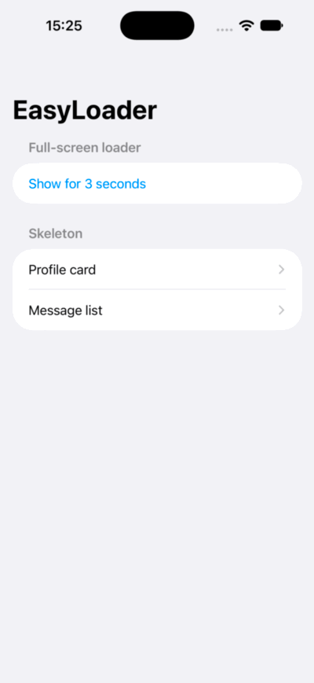

# EasyLoader

Loading states for SwiftUI in one line: a full-screen loader and a shimmering skeleton, with no dependencies.

<p align="center">
  
</p>

```swift
NavigationStack { ... }
    .easyLoaderFull(isPresented: isSaving, message: "Saving…")

ProfileCard(user: user ?? .placeholder)
    .easyLoaderSkeleton(isLoading: user == nil)
```

## Features

- **Full-screen loader:** covers the whole screen and blocks touches while it's showing.
- **Skeleton with shimmer:** one modifier on a container turns everything inside into placeholders.
- **Dark mode:** the default loader follows the system appearance.
- **Your own look:** use colours, images, materials, SF Symbols or any SwiftUI view.
- **App-wide styles:** set a style once at the root, then override it for a section or a single call.
- **Accessibility:** VoiceOver announces loading states, and Reduce Motion replaces spinning and shimmering with a gentle fade.

## Requirements

- iOS 17+ or macOS 14+
- Xcode 16+ (Swift 6.0 tools)

## Installation

In Xcode, go to **File > Add Package Dependencies...** and enter:

```text
https://github.com/YN-Chen/EasyLoader
```

Or add it to your `Package.swift`:

```swift
dependencies: [
    .package(url: "https://github.com/YN-Chen/EasyLoader", from: "1.0.0")
]
```

Then add `"EasyLoader"` to your target's dependencies and import it:

```swift
import EasyLoader
```

## Full-screen loader

Apply it to the outermost view of a screen, such as the `NavigationStack`, so it covers the navigation bar too.

```swift
struct ContentView: View {
    @State private var isSaving = false

    var body: some View {
        NavigationStack {
            Button("Save") {
                isSaving = true
                Task {
                    try? await Task.sleep(for: .seconds(2))
                    isSaving = false
                }
            }
            .navigationTitle("Profile")
        }
        .easyLoaderFull(isPresented: isSaving, message: "Saving…")
    }
}
```

### Styling

Every `LoaderStyle` property has a default, so you only set what you want to change.

```swift
.easyLoaderFull(
    isPresented: isSaving,
    message: "Saving…",
    style: LoaderStyle(
        background: .material(.ultraThinMaterial),
        indicator: .symbol("arrow.triangle.2.circlepath"),
        indicatorTint: .blue,
        messageColor: .primary
    )
)
```

| Property | Default | Options |
|---|---|---|
| `background` | `.system` | `.system`, `.color`, `.image`, `.material`, `.custom` |
| `backgroundOpacity` | `1` | `0` to `1` |
| `indicator` | `.system` | `.system`, `.symbol`, `.image`, `.custom` |
| `indicatorTint` | `nil` | Any `Color`; applies to the system spinner and SF Symbols |
| `indicatorSize` | `.large` | Any `ControlSize` |
| `messageColor` | `.gray` | Any `Color` |
| `messageFont` | `.callout` | Any `Font` |

SF Symbol and image indicators can animate with `.rotate` (the default), `.pulse` or `.none`:

```swift
LoaderStyle(indicator: .symbol("hourglass", animation: .pulse))
```

### Custom views

Use any SwiftUI view as the background or indicator:

```swift
LoaderStyle(
    background: .custom {
        LinearGradient(colors: [.purple, .blue], startPoint: .top, endPoint: .bottom)
    },
    indicator: .custom { MySpinner() },
    messageColor: .white
)
```

Or pass an indicator for a single loader:

```swift
.easyLoaderFull(isPresented: isSaving) {
    MySpinner()
}
```

## Skeleton

Apply it once to a container. While loading, give your views placeholder data so they have a shape to show.

```swift
struct ProfileScreen: View {
    @State private var user: User?

    var body: some View {
        ProfileCard(user: user ?? .placeholder)
            .easyLoaderSkeleton(isLoading: user == nil)
            .task { user = await loadUser() }
    }
}
```

In a `List`, apply it to the rows. Every row shimmers in sync:

```swift
List {
    ForEach(isLoading ? Message.placeholders : messages) { message in
        MessageRow(message: message)
    }
    .easyLoaderSkeleton(isLoading: isLoading)
}
```

Your views keep their `@State` when loading ends, and they can't be tapped while loading.

### Styling

```swift
.easyLoaderSkeleton(
    isLoading: isLoading,
    style: SkeletonStyle(duration: 2, angle: .degrees(0))
)
```

| Property | Default | Options |
|---|---|---|
| `animation` | `.shimmer` | `.shimmer`, `.pulse`, `.none` |
| `duration` | `1.5` | Seconds for one sweep or pulse |
| `angle` | `.degrees(20)` | Tilt of the shimmer band |
| `bandWidth` | `0.3` | `0.05` to `1`, as a fraction of the view's width |
| `dimmedOpacity` | `0.4` | `0` to `1`, how faint placeholders are outside the band |

## App-wide styles

Set a style at the root of your app, or further down to override it for one section. The transform version changes only the properties you name.

```swift
extension LoaderStyle {
    static let brand = LoaderStyle(
        background: .color(.black),
        backgroundOpacity: 0.6,
        indicatorTint: .white,
        messageColor: .white
    )
}

@main
struct MyApp: App {
    var body: some Scene {
        WindowGroup {
            ContentView()
                .easyLoaderFullStyle(.brand)
                .easyLoaderSkeletonStyle(SkeletonStyle(duration: 2))
        }
    }
}
```

```swift
CheckoutView()
    .easyLoaderFullStyle { $0.backgroundOpacity = 0.3 }
```

The order of priority is:

1. A style passed to the modifier
2. The nearest style set in the environment
3. The defaults

## Demo app

Open `Examples/EasyLoaderDemo/EasyLoaderDemo.xcodeproj` and run it to try the full-screen loader, a skeleton profile card and a skeleton list.

## License

EasyLoader is available under the MIT License. See [LICENSE](LICENSE) for details.
